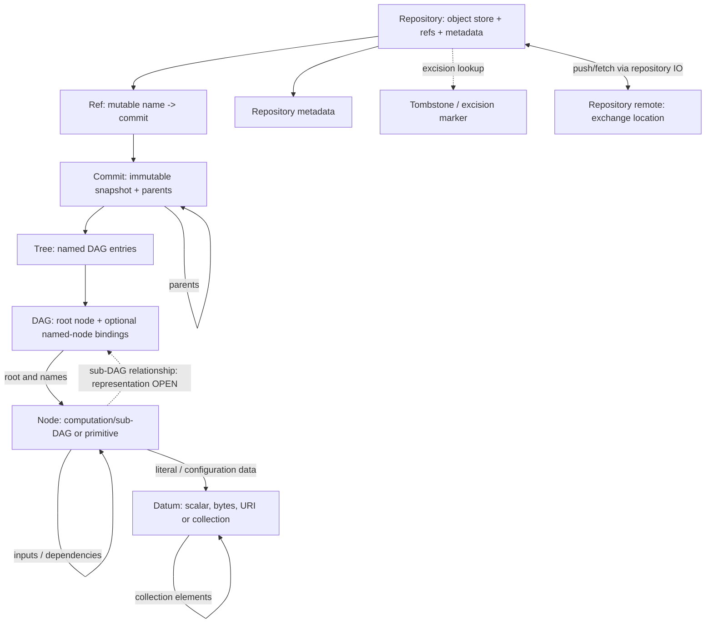
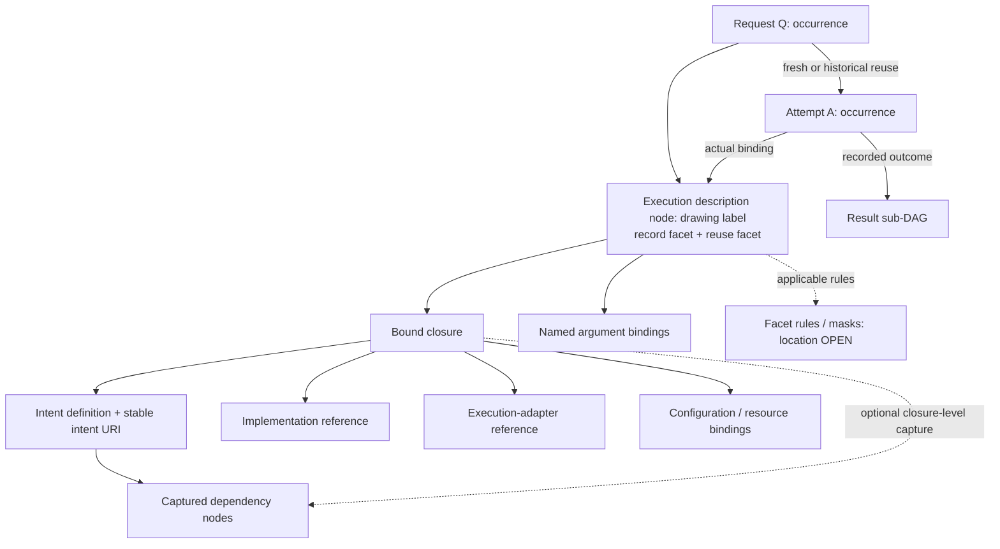
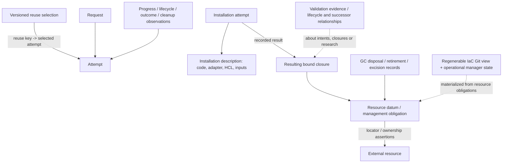

# DML entity map — discussion draft

The image is [design-map.png](design-map.png); a paginated version is
[design-map.pdf](design-map.pdf). Regenerate them with
`python3 diagrams/render-map.py` (requires `pdftoppm`, no Python packages).

This maps all entity roles discussed so far, not every possible future entity.
Terminology follows the [working glossary](../dml/docs/spec-next/glossary.md);
the map does not define
additional meanings or implementation contracts.
**Storage objects and computational roles are different layers, not two competing
object models.** Intents, closures, requests and attempts are being explored as
ordinary DAG data, not assumed to be dedicated core record types.

Arrows within entity panels mean references. Publication arrows mean push/fetch;
installation/materialization arrows are explicitly labeled as processes. Dashed
links denote tentative representation or placement. Facet names and hashing remain
provisional.

## 1. Repository and storage structure



The commit -> tree -> DAG -> node -> datum backbone is context from the existing
[object-model draft](../dml/docs/spec/object-model.md), not newly approved packed
schemas. The existing node-kind taxonomy and exec-pinning layout are not imposed
on this exploration. Nodes referencing sub-DAGs and executing to produce result
sub-DAGs are different relationships; their exact representation remains open.

A named DAG entry labels an existing node; anonymous nodes are reached through
structure. Explicit-scope built-in lookup obtains a node from those bindings.

## 2. Computational roles represented using that structure



“Execution description node” is not a selected core node kind; its exact separation
from the request representation is open. Intents/closures are constructed in a DAG
on a base commit and included with their referenced nodes in the resulting commit.

Arguments and dependencies are already-bound nodes. They are not names resolved
against a moving head at execution time. How they enter the execution's starting
DAG remains open.

## 3. History, resource lifecycle and publication



Selection is branch/commit-scoped state, not mutable research history. Attempts can
have many versioned observations while keeping the same occurrence identifier.
`working` / `done` is separate from computational and cleanup outcomes. Requests
can have multiple attempts, including attempts with unknown outcomes.

Repository refs root full commit history for retention. GC concerns unreachable
history; authorized excision can withdraw resources/content despite retained
references. Tombstones, physical deletion, cleanup custody and erasure assurances
are not identical.

The caller/driver and callee synchronize their local repositories through a shared
DML remote. Illustrative `exec/<attempt-id>` refs advance through commits containing
the execution working DAG. Exact ref names, writer coordination, dispatch and
completion remain open. An execution adapter handles launch/recovery and can wrap a
non-DML program's output into a result DAG. A repository IO adapter is a different
role: it transports repository objects and refs.

Research programs may be driven by an experiment Git repository. That Git history
identifies orchestration context, not necessarily all computational dependencies.
Deployment tooling is user-selected; no CI backend is part of the proposed core.
Sidecar observers are ordinary consumers of recorded DAGs, not a special subsystem.

## Identity and facet inventory

A **record/content facet** below means immutable recorded-object identity in the
explored direction, not a newly selected hashing format. **No additional facet
selected** is deliberate: we should not invent identities without an operation
that needs them.

| Entity / role | Identity or facet so far | Other identity-related information |
| --- | --- | --- |
| Datum | Record/content facet | Collections reference datums; URI identity does not prove external content identity |
| Node | Record/content facet | Named or anonymous; names are scoped labels, not global IDs |
| Execution description node | Record facet and **masked reuse facet** | Mask contributes to full record identity; exact dimensions OPEN |
| DAG / sub-DAG | Record/content facet | Root and named bindings; no separate topology/value facet selected |
| Tree | Record/content facet | Named DAG entries; no additional facet selected |
| Commit | Record/content facet | Snapshot, parents and versioned research state; not a blanket computation cache key |
| Ref / head / index / tracking or execution ref | Mutable repository-scoped name and target | Navigation/root/publication pointer, not a content-addressed computational facet; taxonomy OPEN |
| Repository | Store/access identity not selected as a computational facet | Holds objects, refs and metadata |
| Repository metadata | Schema/tool metadata in existing draft | Not assumed to be versioned research or a reuse input |
| Remote / repository IO adapter | Exchange locator/access mechanism and adapter binding | Publication location does not automatically affect computation reuse |
| Tombstone | Identifies withdrawal of a referenced object | Exact new-design identity/lookup semantics OPEN; not the original content |
| Intent definition | Record/content facet | Stable URI spans definition versions; URI alone is not a cache key |
| Implementation / execution adapter | Recorded reference/binding identity | External code/version capture is researcher-controlled |
| Bound closure | Record/content facet | No separate closure reuse facet selected; dimensions feed execution facets |
| Arguments / captured dependencies | Node and binding-structure identities | Explicit-scope name lookup; fixed binding, not late selection |
| Facet rule / mask | Included in full recorded node identity | Sentinel means intentionally ignored, not unknown; location/defaults OPEN |
| Request | Versioned record identity plus occurrence ID | Reuse hit remains a new request |
| Attempt | Versioned record identities plus occurrence ID | Distinct attempts can match every computational facet and result |
| Result DAG | Record/content facet | Equal result DAGs do not merge attempts |
| Progress / outcome / cleanup observations | Versioned recorded facts linked to an occurrence | Additional observations do not create another computational trial |
| Reuse selection | Versioned selection state | Maps reuse identity to an attempt; fresh execution and adoption are separate |
| Installation description / installation attempt | Record identity / occurrence identity, tentatively | Installation can produce a bound closure; no additional facet selected |
| Resource datum / obligation | Recorded description/binding identity | External instance identity, ownership and retention are separate |
| External resource | Provider/authority-specific real-world identity | Not automatically content-addressed or immutable |
| Disposal / retirement / excision records | Versioned requests and observations | Deletion request is not proof of physical deletion |
| Lifecycle / successor / validation evidence | Versioned DAG data and relationships | Not automatically a computational-key dimension |
| IaC Git view / operational manager state | Backend-specific configuration/state identities | Regenerable view; state registration and actual effects remain distinct |
| Experiment Git repository / run context | Git identity and recorded associations | Not automatically a global cache-busting dimension |
| Caller / callee / driver / deployment tools / observer | Actor or tool roles, not core object facets | They use repository mechanisms; execution binding can identify relevant tools |

Existing dedicated `exec` and `exec_request` records are historical spec context,
not assumed to implement the newly discussed request/attempt/selection model.
No byte layout, LMDB keyspace or special observer machinery is selected by this map.

## Concrete identity example

```text
Description E1: adapter = local, adapter dimension ignored
Description E2: adapter = remote, adapter dimension ignored

record_facet(E1) != record_facet(E2)
reuse_facet(E1)  == reuse_facet(E2)

Fresh attempts A1 and A2 remain separate even if both execute E1
and produce the same result DAG.
```

Reuse equality is purpose-specific: it does not authorize full-record deduplication,
erase actual binding differences or create another independent observation.
