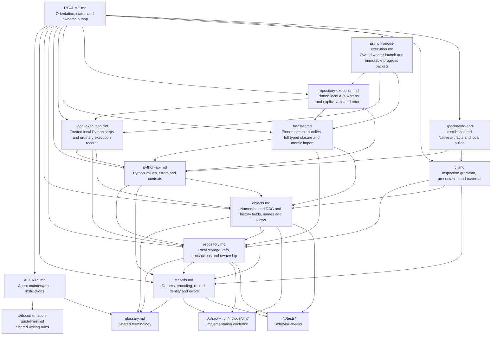

# DML: the evolving as-built specification

Status: implemented subset, growing through the design spiral. The datum foundation
was initially inspected at `638cc42`; the minimum viable repository extends it with
literal/sub-DAG-reference nodes, named DAGs, trees, commits and transactional refs.

## Authority boundary

This document owns navigation and the concept-to-document map for this
**new-direction, as-built specification**. Technical contracts belong to the
documents below. Documented functionality defines the implemented scope; there
is no separate inventory of future or missing features.

Follow [Documentation Writing Guidelines](../documentation-guidelines.md),
especially Sections 2–5. The existing [draft specification](../spec/overview.md)
remains untouched. Its proposed functionality is not automatically inherited as
implemented behavior or as a requirement of this new direction.

## Start here

- Humans: read this page, then the technical document relevant to your task.
- Agents: also read [AGENTS.md](AGENTS.md).
- Vocabulary: use the shared [glossary](glossary.md).
  Glossary inclusion does not establish implemented behavior; technical contracts
  remain in this specification.
- Implementation: [C sources](../../src/) and [public headers](../../include/dml/).
- Design discussion and iteration planning live separately in
  [dml-design](../../../dml-design/README.md), not in normative technical sections.

## Document map

The diagram is informative. Arrows mean documentation references, not runtime
object relationships.

## Concept ownership

| Topic | Authority within this specification |
| --- | --- |
| Navigation and documented scope | This README |
| Agent maintenance procedure | [AGENTS.md](AGENTS.md) |
| Shared documentation style and authority conventions | [Documentation Writing Guidelines](../documentation-guidelines.md) |
| Shared vocabulary, not implementation contracts | [Glossary](glossary.md) |
| Datum kinds, canonical records, record IDs, URI/text behavior and error representation | [records.md](records.md) |
| Literal/sub-DAG-node/DAG/tree/commit bodies, name profile, ordering and codec views | [objects.md](objects.md) |
| Repository initialization, storage keys, transactions, direct reference checks, refs and handle ownership | [repository.md](repository.md) |
| Python conversions, owned descriptions, exceptions, thread/finalizer policy and contexts | [python-api.md](python-api.md) |
| Trusted local Python execution, record conventions, publication and capture limits | [local-execution.md](local-execution.md) |
| Pinned commit bundles, supported profile, complete typed reachability and atomic optional-ref import | [transfer.md](transfer.md) |
| One pinned step across local repositories, retained workspaces and selected-completion return validation | [repository-execution.md](repository-execution.md) |
| Saved observation identity, live worker ownership, coherent progress discovery and immutable P/U/F packets | [asynchronous-execution.md](asynchronous-execution.md) |
| Inspection CLI grammar, traversal, previews, JSON and diagnostics | [cli.md](cli.md) |
| Native linking, packaged executable, build/install and distribution paths | [Packaging and distribution](../packaging-and-distribution.md) |

## What exists today

- A C codec for all ten datum kinds, deterministic record encoding and IDs.
- UTF-8/NFC and URI validation/canonicalization helpers.
- Literal and non-executing sub-DAG-reference nodes, rooted DAGs with scoped named
  bindings/lookup, named trees and ordered-parent commits with full-record IDs.
- An LMDB-backed local repository storing immutable objects and mutable refs in
  storage transactions.
- C tests and Python tests driving native test helpers, including fresh-process
  snapshot/history inspection and atomic object/ref rollback.
- A linked low-level Python API constructing and reading that state through real
  native handles, with explicit references and atomic transaction contexts.
- A separate explicit Python local-execution layer recording pinned requests,
  distinct attempts, cooperative child result publication and separate computation/
  cleanup outcomes through ordinary DAGs, commits and refs.
- A separate explicit Python transfer layer exporting complete all-parent typed
  immutable object closures and importing bounded bundles atomically with optional
  create-or-same-target refs, preserving bytes/IDs/occurrences without execution.
- An explicit Python exchange layer composing pinned transfer, one fresh step in
  independent local B and selected-history validation before return import under a
  caller-chosen A ref, leaving existing A heads unchanged.
- Additive asynchronous launch/observe/receive with separate application-owned live
  process and saved handle, coherent pinned P/U/F packets and independent explicit-ref
  reception, without turning provisional publication/unknown history into final success.
- A native inspection CLI and Python console forwarding to the bundled executable,
  with human/JSON presentation, snapshots, named lookup, nested DAG traversal and
  all-parent history traversal.

## Development policy

Until `v1.0.0`, DML repositories and development state are ephemeral. Iterations do
not require version increments, compatibility layers or data migrations. Existing
format/schema numbers describe the current implementation; they do not establish
pre-1.0 persistence guarantees. Recreating incompatible development data is allowed
by this policy; deleting unrelated data or unmanaged resources is not.

Prefer minimal prototypes and frequent iterations. A turn may explore breadth or
depth as useful; it need not finish one subsystem before exploring another. In
this spec, distinguish shortcuts, unsupported cases and tested capabilities.

As functionality lands, add its owning document and update this map in the same
scoped change. Use the shared guideline change process, but do not publish intended
behavior as implemented before the corresponding code exists.

## Reading technical sections

Technical documents describe the current implemented contract. MUST, SHOULD and
MAY are normative when used there; examples are explicitly informative. Source and
test links provide evidence; actual validation runs and outstanding gates are in the
[Iteration 1 delivery notes](../../../dml-design/iterations/01-minimum-viable-repository/RESULTS.md)
and [Iteration 2 delivery notes](../../../dml-design/iterations/02-repository-usability/RESULTS.md)
and [Iteration 3 results](../../../dml-design/iterations/03-composable-dags/RESULTS.md)
and [Iteration 4 results](../../../dml-design/iterations/04-local-recorded-execution/RESULTS.md)
and [Iteration 5 results](../../../dml-design/iterations/05-pinned-snapshot-transfer/RESULTS.md)
and [Iteration 6 results](../../../dml-design/iterations/06-local-repository-execution/RESULTS.md)
and [Iteration 7 results](../../../dml-design/iterations/07-asynchronous-local-execution/RESULTS.md).
If code, tests and this spec disagree, report the
mismatch rather than silently treating a design proposal as implemented behavior.
