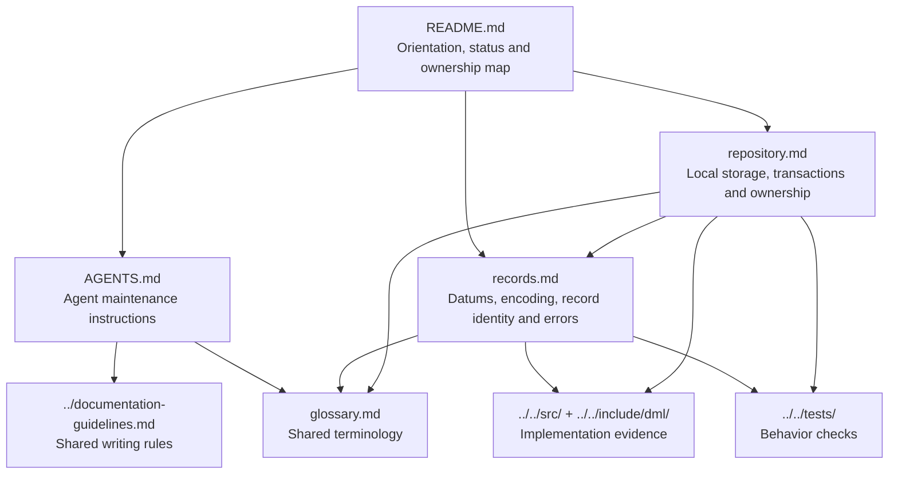

# DML: the evolving as-built specification

Status: implemented subset, growing through the design spiral. The initial source
inspection is at commit `638cc42`; the implementation has not changed to create
this specification.

## Authority boundary

This document owns navigation and the concept-to-document map for this
**new-direction, as-built specification**. Technical contracts belong to the
documents below. Documented functionality defines the implemented scope; there
is no separate inventory of future or missing features.

Follow [Documentation Writing Guidelines](../documentation-guidelines.md),
especially Sections 2–5. The existing [draft specification](../spec/overview.md)
remains untouched. Its proposed functionality is not automatically inherited as
implemented behavior or as a requirement of this new direction.

## Start here

- Humans: read this page, then the technical document relevant to your task.
- Agents: also read [AGENTS.md](AGENTS.md).
- Vocabulary: use the shared [glossary](glossary.md).
  Glossary inclusion does not establish implemented behavior; technical contracts
  remain in this specification.
- Implementation: [C sources](../../src/) and [public headers](../../include/dml/).
- Design discussion and iteration planning live separately in
  [dml-design](../../../dml-design/README.md), not in normative technical sections.

## Document map

The diagram is informative. Arrows mean documentation references, not runtime
object relationships.

## Concept ownership

| Topic | Authority within this specification |
| --- | --- |
| Navigation and documented scope | This README |
| Agent maintenance procedure | [AGENTS.md](AGENTS.md) |
| Shared documentation style and authority conventions | [Documentation Writing Guidelines](../documentation-guidelines.md) |
| Shared vocabulary, not implementation contracts | [Glossary](glossary.md) |
| Datum kinds, canonical records, record IDs, URI/text behavior and error representation | [records.md](records.md) |
| Repository initialization, storage keys, transactions, reference checks and handle ownership | [repository.md](repository.md) |

## What exists today

- A C codec for all ten datum kinds, deterministic record encoding and IDs.
- UTF-8/NFC and URI validation/canonicalization helpers.
- An LMDB-backed local repository storing immutable datums in transactions.
- C tests and Python tests driving native test helpers.
- Version-only/scaffold CLI, Python package and example adapter entry points.

## Development policy

Until `v1.0.0`, DML repositories and development state are ephemeral. Iterations do
not require version increments, compatibility layers or data migrations. Existing
format/schema numbers describe the current implementation; they do not establish
pre-1.0 persistence guarantees. Recreating incompatible development data is allowed
by this policy; deleting unrelated data or unmanaged resources is not.

Prefer minimal prototypes and frequent iterations. A turn may explore breadth or
depth as useful; it need not finish one subsystem before exploring another. In
this spec, distinguish shortcuts, unsupported cases and tested capabilities.

As functionality lands, add its owning document and update this map in the same
scoped change. Use the shared guideline change process, but do not publish intended
behavior as implemented before the corresponding code exists.

## Reading technical sections

Technical documents describe the current implemented contract. MUST, SHOULD and
MAY are normative when used there; examples are explicitly informative. Source and
test links provide evidence, not a claim that a fresh test run occurred during this
initial documentation pass. If code, tests and this spec disagree, report the
mismatch rather than silently treating a design proposal as implemented behavior.
