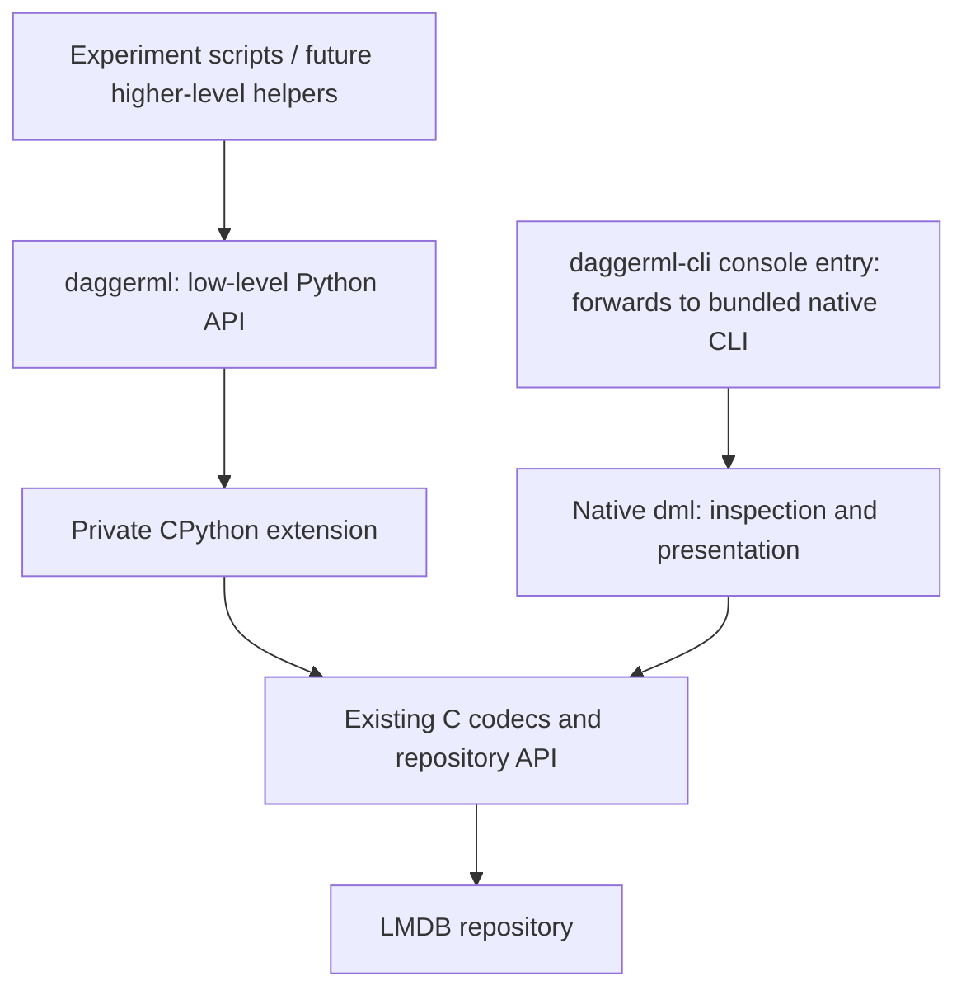

# Iteration 2 design: repository usability

Status: detailed design for the agreed usability iteration. Following review, the
user authorized bounded implementation, coordinator monitoring and review fixes.
The exact engineering choices below remain identifiable proposals, to be selected
and recorded during implementation. See [HANDOFF.md](HANDOFF.md) for authorization,
acceptance evidence and the implementation stop line.

**Delivery:** the bounded turn is implemented and independently reviewed; see
[RESULTS.md](RESULTS.md), [REVIEW.md](REVIEW.md) and the owning as-built contracts.
The candidate design below preserves planning-time proposals and examples; its
statements about unimplemented behavior describe preparation, not current status.

## 1. Authority boundary

This document owns the candidate design for this iteration. It is not an as-built
specification. Existing implemented contracts belong to the
[as-built specification](../../../dml/docs/spec-next/README.md), especially
[records](../../../dml/docs/spec-next/records.md),
[objects](../../../dml/docs/spec-next/objects.md) and
[repository operations](../../../dml/docs/spec-next/repository.md).
The [glossary](../../../dml/docs/spec-next/glossary.md) owns terminology.

### User-agreed scope

- A low-level Python repository API over the existing C foundation, covering
  construction and reading of all existing immutable object kinds, ref operations
  and explicit storage transactions.
- An inspection-only CLI, with human-readable and JSON output.
- Higher-level conveniences can be separate layers composed over the low-level
  API. They need no privileged repository access and are outside this turn.
- Both interfaces share repository concepts and semantics. CLI mutation capability
  parity is deliberately deferred, appropriate to the agent-first workflow.
- Acceptance: Python records 42, then 43 in a child commit and moves a ref; the CLI
  inspects both snapshots and their history without changing earlier objects.
- No execution, new computational DAG semantics, intents, closures, reuse, remotes,
  merge/rebase, GC/excision, resource management or observer subsystem.

All concrete choices in Sections 3–9 are assistant proposals within that scope.
Consequential deviations should be surfaced during implementation rather than
silently promoted to user agreements.

## 2. Inspected baseline and architectural problem

At preparation, the implementation checkout is clean at `06bf66e`, following the
published Iteration 1 follow-up `6ee9329` and a separate C language-server setup
commit. This is inspection provenance, not a request to check out that revision.
No test suite was rerun in preparing this design.

Existing public C headers supply codecs, IDs, repository handles, transactions,
typed object reads/writes and ref create/get/update. The native drivers in
`tests/c/` let Python tests invoke those operations in subprocesses. They are not
Python bindings or a supported user CLI.

There are already two CLI entry points:

- Native `src/cli.c`, built as `build/check/dml`, currently version-only.
- The `daggerml-cli` Python distribution's `dml` console script, currently a scaffold.

The `daggerml` Python distribution has a CPython extension scaffold, but its version
function is hard-coded and it does not currently link the real C repository core.
This turn needs to connect these existing entry points deliberately, not invent
an unrelated `dml` Python package or leave two conflicting CLI meanings.

### Proposed architecture



The native CLI remains directly usable without a Python runtime. The Python console
entry forwards arguments and exit status to the same native implementation, not a
second command implementation. The binding calls C directly, not the CLI or test
drivers. Presentation and orchestration may be Python code; canonical encoding,
hashing, integrity validation and persistence remain C responsibilities.

## 3. Python values and object identity

Use the existing import name, illustratively `import daggerml as dml`. Keep
`daggerml.version()`, now reporting the linked C core's version.

### ObjectId

Propose an immutable, hashable `ObjectId` wrapping exactly 16 bytes:

- `ObjectId.from_hex(text)` and `str(id)` use the C lowercase 32-hex contract.
- `id.bytes` returns immutable bytes. Equality/hash compare content bytes.
- It is not a ref, repository handle, occurrence identifier or reuse identity.
- IDs remain untyped, matching C; typed operations establish expected object kinds.
- Construction from an arbitrary integer, path or implicit hex string is rejected.
  Repository methods take `ObjectId`, avoiding implicit parsing at every boundary.

### Datum

Return an immutable `Datum(kind, value)` description from `get_datum()`, not a
recursively dereferenced Python container. Retaining the kind distinguishes URI
from STRING and LIST from SET, and keeps collection edges inspectable.

For `put_datum()`, accept either a `Datum` or these unambiguous scalar values:

| Python input | Recorded kind |
| --- | --- |
| `None` | NULL |
| `bool` | BOOL; check before integer |
| `int` in signed 64-bit range | I64; no float coercion |
| `float` | F64 |
| `bytes` | BYTES |
| `str` | STRING |

Reject other implicit conversions. In particular, a Python list, set or dict does
not recursively insert children. Provide explicit constructors:

```python
dml.Datum.uri("https://example.org/data")
dml.Datum.list([datum_id_a, datum_id_b])
dml.Datum.set([datum_id_a, datum_id_b])
dml.Datum.map([(key_id, value_id), (other_key_id, other_value_id)])
```

Also provide explicit scalar constructors such as `Datum.i64(42)` and
`Datum.string("text")` for callers wanting uniform typed descriptions. Collections
store tuples of IDs or pairs, not mutable caller-owned lists. MAP uses pairs rather
than a Python dict so duplicate-key rejection is not defeated before C sees it.
SET uses a sequence for the same reason. Inputs are structurally copied, not
silently deduplicated. Canonical ordering and duplicate rejection remain C's job.

Decoded values are `None`, bool, int, float, bytes or str for scalars; tuple of IDs
for LIST/SET; tuple of ID pairs for MAP. No read recursively loads child datums.

The C codec owns NFC normalization, canonical float encoding and URI rules. A URI
constructor marks the kind; it does not quietly canonicalize or dereference text.
Expose `canonicalize_uri(text) -> str` as a separate operation backed by C. For
example, `Datum.uri(canonicalize_uri(text))` makes the normalization choice explicit.

### Snapshot/history descriptions

Getters return immutable, owned descriptions:

| Getter | Proposed result |
| --- | --- |
| `get_node(id)` | `LiteralNode(datum: ObjectId)` |
| `get_dag(id)` | `DAG(root: ObjectId)` |
| `get_tree(id)` | `Tree`, a read-only mapping from names to DAG IDs |
| `get_commit(id)` | `Commit(tree: ObjectId, parents: tuple[ObjectId, ...])` |

Tree iteration follows canonical stored name order. Commit parent order is
preserved. No result retains a borrowed LMDB or C-view pointer. Descriptions remain
usable after the transaction and repository close; fetching another referenced
object requires a live transaction.

Descriptions do not lazily execute or recursively resolve objects. Tree names are
not named bindings inside a DAG. A DAG is still only the rooted object implemented
in Iteration 1.

## 4. Python repository and transaction API

### Proposed surface

```python
Repository(path, *, create=False, map_size=0)
repo.schema                 # existing repository schema number
repo.read()                 # read transaction/context manager
repo.write()                # write transaction/context manager
repo.close()

# Both transaction modes
 tx.get_datum(id) -> Datum
 tx.get_node(id) -> LiteralNode
 tx.get_dag(id) -> DAG
 tx.get_tree(id) -> Tree
 tx.get_commit(id) -> Commit
 tx.get_ref(name) -> ObjectId
 tx.get_record(kind, id) -> bytes
 tx.abort()

# Write transactions only
 tx.put_datum(value_or_datum) -> ObjectId
 tx.put_literal(datum_id) -> ObjectId
 tx.put_dag(*, root) -> ObjectId
 tx.put_tree(entries) -> ObjectId
 tx.put_commit(tree_id, *, parents=()) -> ObjectId
 tx.create_ref(name, commit_id)
 tx.update_ref(name, commit_id)
 tx.commit()
```

`get_record()` exposes exact immutable record bytes through the C typed getter;
`kind` is one of datum/node/dag/tree/commit, not arbitrary stored keys. It supports
independent inspection and immutable-byte tests without adding a public raw LMDB
API. A general packed-record writer is unnecessary for this turn.

`put_tree()` can accept a mapping or a sequence of `(name, dag_id)` pairs. The latter
lets callers preserve duplicates until the C codec rejects them. Python does not
impose a new name profile or silently merge names. No implicit upsert, ref deletion,
ref listing, default branch, checkout, merge or automatic snapshot construction.

Accept filesystem paths through `os.PathLike`/`str`, reject embedded NULs before C,
and document the implemented platform encoding boundary. Repository creation keeps
existing C behavior: an existing parent is required and unrelated nonempty
locations are rejected. This API does not create parent directories automatically.
`map_size=0` means the C default; no automatic growth or partial map-full retry.

### Lifetime and contexts

- Constructing a repository opens it; entering its context returns that repository.
- A transaction is begun when `read()`/`write()` returns it. Entering it returns
  itself. Do not permit repeated entry, nested contexts for the same handle, or
  multiple simultaneously active transactions on one Python repository wrapper in
  this first implementation. This is a deliberate wrapper restriction, not a new
  limitation claimed for all C clients.
- Normal exit from a write context commits its storage transaction. Exceptional
  exit aborts; the original exception propagates.
- Normal or exceptional exit from a read context aborts/ends it; it never invokes
  C's rejected read-commit operation.
- Explicit `commit()` is write-only and consumes the transaction on success or
  failure. Explicit `abort()` consumes it and is idempotent.
- Context exit after explicit commit/abort does not commit again. Other operations
  on ended handles raise a state error before entering C.
- `close()` is idempotent after successful close, but rejects active transactions.
  Transaction objects keep their repository owner alive.
- Repository context exit aborts a still-active transaction before closing. This
  is a cleanup safeguard, not permission to suppress an exception or an earlier
  commit error. An unexpectedly open write transaction is never implicitly
  committed by repository exit.
- Best-effort finalizers may release abandoned handles, but are not the supported
  transaction completion mechanism. Never commit from a finalizer. Specify and
  test destruction order; avoid reference cycles involving live native handles.

For simplicity, bind the Python wrapper's repository and transaction operations
to their creating thread, checking before native handle access. No GIL-based claim
of thread safety, background workers, async contexts or automatic locking protocol.
The C API's external synchronization requirements remain. A second wrapper for the
same physical repository in one process is not a supported workaround; do not add
a global path/handle registry in this turn. Separate processes remain the primary
acceptance boundary.

### Errors and failed writes

Expose a `DmlError` carrying `code` (C status name), `native_code` and `detail`.
Use a small useful subclass set, for example `NotFoundError`, `InvalidStateError`,
`IntegrityError` and `MapFullError`; other C errors can use the base class. Preserve
the C error classification rather than turning every missing reference into the
same Python exception. Python argument/type/range failures may use `TypeError`,
`ValueError` or `OverflowError` before entering C. C allocation failures should
retain their structured status, even if a dedicated allocation-error subclass is
used; CPython's own allocation failures remain `MemoryError`.

A failed public mutation should mark the wrapper's write transaction unusable even
if failure occurred in argument conversion or encoding before the native put.
This conservative wrapper rule makes catching a mutation error safe: callers
cannot accidentally auto-commit earlier writes. Abort the native handle or mark
it failed and ensure later commit aborts; record which choice was implemented.
Reads and failed lookups do not poison an otherwise usable write transaction.

If a mutation exception is caught inside a write context, normal context exit
raises a state error and rolls back; it is not success. Native put/ref errors keep
the existing poison contract. A commit error always consumes the handle. Cleanup
errors must not erase the original exception or leak a transaction.

## 5. Acceptance example

Informative example using the candidate surface; it is not working code today.

```python
import daggerml as dml

with dml.Repository("research.dml", create=True) as repo:
    with repo.write() as tx:
        value = tx.put_datum(42)
        node = tx.put_literal(value)
        dag = tx.put_dag(root=node)
        tree = tx.put_tree({"example": dag})
        first = tx.put_commit(tree)
        tx.create_ref("main", first)

    with repo.write() as tx:
        value = tx.put_datum(43)
        node = tx.put_literal(value)
        dag = tx.put_dag(root=node)
        tree = tx.put_tree({"example": dag})
        second = tx.put_commit(tree, parents=[first])
        tx.update_ref("main", second)

    with repo.read() as tx:
        head = tx.get_ref("main")
        commit = tx.get_commit(head)
        dag = tx.get_dag(tx.get_tree(commit.tree)["example"])
        node = tx.get_node(dag.root)
        result = tx.get_datum(node.datum)
        assert result.kind == "i64" and result.value == 43
```

The kind string is illustrative; choose and document a stable enum/string surface
before coding. Earlier discussion returned a bare `43` from `get_datum()`; this
proposal instead retains `Datum.kind` and requires `.value` for that comparison.
This is an explicit proposed refinement, not a silently changed agreement.

Record first/second IDs and record bytes for fresh-process CLI checks. Add C3 with
parent C1 to demonstrate branching using Python, without a branch-management API.

## 6. Inspection CLI

### Proposed command grammar

```sh
dml --version                         # retain -V too
dml --help
dml --repo research.dml ref get main
dml --repo research.dml show datum <id>
dml --repo research.dml show node <id>
dml --repo research.dml show dag <id>
dml --repo research.dml show tree <id>
dml --repo research.dml show commit <id>
dml --repo research.dml snapshot --ref main
dml --repo research.dml snapshot --commit <id>
dml --repo research.dml log --ref main
dml --repo research.dml log --commit <id>
```

Place global `--json` before the command. `--repo` is required for repository
commands; do not infer a current repository, create one or pick a default ref.
Snapshot/log require exactly one of `--ref` and `--commit`. Explicit selection
avoids guessing whether a hex-shaped ref name means a commit ID.

`show` requires the type because existing C storage reads are type-qualified.
Do not add a repository enumeration API just to infer types. All ID arguments use
the existing lowercase hex rules. Unsupported commands/options report usage errors.
No CLI init, put, commit, ref create/update or raw-write command in this turn.

### Read-only behavior

Each repository command opens without creation and uses one read transaction for
all resolution/traversal, providing a consistent local snapshot. It performs no
object or ref writes and does not repair corrupt stores. Existing C open uses an
LMDB environment with ordinary filesystem access; this is not a promise of an
OS-level read-only open or zero lock-file activity. Supporting a physically
read-only filesystem is a separate capability, not silently claimed here.

### Command results

- `ref get`: target commit ID; normal C ref validation applies.
- `show`: object ID/type, fields and immediate references. For datum, include its
  kind and value/reference collection, without recursively resolving elements.
- `snapshot`: selected commit ID, ordered parents, tree ID, total tree-entry count,
  and entries in canonical name order. For displayed entries load the DAG, root
  literal node and root datum, giving each ID and a bounded datum preview. No
  recursive composite-datum expansion.
- `log`: commit ID, tree ID and ordered parent IDs for each visited commit. Traverse
  all parents, not an implicit first-parent history. Proposed deterministic order
  is depth-first preorder using stored parent order, showing shared ancestors once.
  Track active/visited IDs to detect a traversed cycle and avoid repeated expansion.
  A depth limit is not a graph-validity proof. Prefer iterative traversal over C
  recursion. Corrupt or missing visited objects fail rather than inventing history.

Snapshot and log accept a positive `--limit`, default 100, respectively bounding
entries displayed and distinct commits displayed. Include `truncated` in JSON.
For log, mark truncation only if unvisited work remains after the limit; for snapshot,
compare displayed entry count with total count. Tree order and traversal order are
not chronological timestamps. No timestamps or commit messages exist to display.

Human datum previews cap string/URI at 80 Unicode code points, bytes at 32 bytes,
and collection IDs/pairs at 8 entries. Escape controls and terminal escape bytes;
show omitted counts and explicit truncation. Limits bound presentation, not the
size of the existing C record allocation or the number of bytes read from LMDB.

`show --json` (spelled with the global option before `show`) returns complete fields
for the requested object; it can be large. Human `show` bounds datum previews but
may display complete tree entries/parents. No hidden model calls or domain analysis.

### JSON contract

Use one UTF-8 JSON document plus newline on success, with explicit object/command
fields. Never serialize IDs or I64 values as JSON numbers. Do not emit nonstandard
JSON NaN/Infinity. Proposed shapes:

```json
{"command":"ref-get","name":"main","target":"<commit-id>"}
```

```json
{"command":"show","type":"datum","id":"<datum-id>","datum":{"kind":"i64","value":"43"}}
```

```json
{"command":"show","type":"commit","id":"<commit-id>","tree":"<tree-id>","parents":["<parent-id>"]}
```

All IDs are lowercase hex strings. Remaining full object shapes:

| Object | Fields in addition to `command`, `type`, `id` |
| --- | --- |
| Node | `kind: "literal"`, `datum: <id>` |
| DAG | `root: <node-id>` |
| Tree | `entries: [{name, dag}, ...]` in canonical order |

Full datum values use null/bool directly; I64 decimal strings; F64 strings (finite
round-trippable decimal, `nan`, `inf`, `-inf`); bytes lowercase hex strings with
`encoding: "hex"`; STRING/URI JSON strings; LIST/SET ID arrays; MAP arrays of
`{key, value}` ID pairs. Float output is locale-independent and canonical zero
prints `0`. Compare NaNs by kind/canonical encoding, not Python NaN equality.

Snapshot JSON contains `command`, `commit`, `tree`, `parents`, `entry_count`,
`entries` and `truncated`. Each entry contains `name`, `dag`, `root`, `datum` (IDs)
and `preview`. A preview is an object with `kind`, `value`, `truncated` and optional
`total_count`/`encoding`, using the value conventions above but bounded by the
preview limits. Log JSON contains `command`, `start`, `commits` (each with `id`,
`tree`, `parents`) and `truncated`.

Fix field spellings and examples before implementation. Formatting/key order should
be deterministic for the same command/input; clients consume fields, not spacing.
No API version framework or persistent schema migration machinery in this turn.

### Exit status and diagnostics

- 0: success, including deliberately bounded output marked truncated.
- 2: syntax/usage error, including malformed ID/limit arguments.
- 1: repository, integrity, unsupported-schema or other runtime failure.

Successful commands write results to stdout and no diagnostic to stderr. Errors
write no partial result document to stdout. Human errors go to stderr; JSON mode
uses one stderr JSON object containing `error.code`, `error.native_code` and
`error.detail` (null native code for parser errors). Parser errors can additionally
identify the offending option without dumping repository values. Build/validate
bounded traversal results before output so late errors do not leave success-looking
partial JSON. Handle output-write failure as an error, not successful inspection.

Version behavior remains usable without a repository. Help is success; invoking
with no command remains a usage error. Document this deliberately rather than
retaining the Python scaffold's successful no-command message.

## 7. Native binding and distribution seam

### Binding recommendation

Extend the existing CPython extension, linking the actual core. Use Python code
for immutable descriptions and ergonomic context wrappers where useful; use native
opaque handles for repository/transaction ownership. Avoid serializing live pointers
as Python integers. Copy data before freeing C buffers and check conversions,
counts, sizes and errors before entering the codec.

Use the existing limited-API/abi3 direction if it supports the chosen handle design
without contortions. Do not silently abandon supported Python/platform declarations
or claim compatibility without building it. CPython API, Meson and meson-python
details need current documentation checks during implementation; this design does
not prescribe unverified API calls.

### One core, one CLI implementation

The root Meson build should compile the binding for integration tests alongside the
C library and native CLI. Test imports must find that freshly built extension,
not an installed stale version or a monkeypatched scaffold.

For Python distributions, propose that the `daggerml` wheel contains the extension
and a private native executable at a package-relative location such as
`daggerml/_bin/dml-native[.exe]`. The `daggerml-cli` console entry invokes that exact
bundled executable, forwards arguments/streams and preserves status. Do not search
PATH for `dml`, which may recursively find the console entry itself. Module execution
and the installed console entry use the same forwarding function.

The core sources remain one maintained implementation. Source distributions need
the native sources/dependencies they build; a wheel built from the implementation
checkout is insufficient evidence that a source distribution is self-contained.
Use a small shared Meson definition or controlled source-distribution staging rather
than a second handwritten copy of the core. Exact build layout is an implementation
checkpoint: inspect available packaging machinery and resolve a minimal route
before spending the turn on a packaging redesign. If self-contained wheel/sdist
construction needs substantially broader infrastructure, report the blocker and
request a bounded decision; do not silently deliver only a source-tree mock.

No package publication, release tags or cloud builds. Test an isolated local install
and run Python plus console inspection outside the checkout. Packaging work exists
to make this API usable, not to revise unrelated adapter or release architecture.

## 8. Validation design

Keep existing native-driver property/corruption tests. Add public Python API tests
and native/packaged CLI tests using real linked C code. Update scaffold assertions
that intentionally describe replaced behavior; do not remove independent low-level
byte or integrity oracles.

### Python boundary cases

- All ten datum kinds; scalar type/range rules; composite IDs not auto-dereferenced.
- Canonical string/float/URI behavior and duplicate SET/MAP/tree rejection.
- Correct object types, missing/wrong-type references, parent order and empty trees.
- Same IDs/record bytes as existing C golden vectors and native drivers.
- Atomic initial snapshot/ref, subsequent snapshot/ref update and branching.
- Abort, native poison, and Python conversion/codec failure after earlier writes.
- Caught mutation error cannot cause auto-commit; caught read error need not poison.
- Explicit commit/abort followed by context exit; ended-handle operations.
- Read writes rejected; active-close rejection; context cleanup; owner lifetime;
  cross-thread rejection; descriptions surviving closure; map-full full-batch retry.
- Native buffer/handle cleanup on conversion/allocation failures. Use narrow private
  test fixtures for meaningful failures, not installed fault controls.

### CLI boundaries

- Fresh process sees Python-created state and earlier snapshots by ID.
- Native and packaged entry produce equivalent output/status for the same fixture.
- All show types and every datum kind, including huge I64 and nonfinite F64 JSON.
- Snapshot canonical ordering, preview limits, escaping and truncation metadata.
- Log zero/one/multiple parents, shared ancestors once, deterministic limits.
- Unknown refs/objects, malformed inputs, wrong types, schema and corruption errors.
- One read-transaction consistency and no object/ref mutation. Do not assert lock
  files never change as proof of read-only behavior.
- stdout/stderr/exit conventions, no partial JSON on late failure, output-write error.
- Missing/invalid bundled executable and path spaces; no PATH recursion.

### Assurance accounting

Extend standard validation to include the real binding, its native source coverage,
Python wrappers and CLI presentation code. Do not let an uninstrumented extension
escape the existing C thresholds or let installed subprocesses escape Python-source
measurement. Measure the forwarding code directly as well as through subprocess
integration. Narrow documented no-value exclusions remain allowed; meaningful
failure paths need tests. Default gates and informational `-c` remain distinct.
Memory checks should cover binding allocations/handles, not only unrelated C tests.
Report which mutation/memory/platform checks actually ran and which did not.

## 9. Design checkpoints and stop line

Before implementation, confirm the detailed candidate or record replacements for:

1. Typed `Datum` read results versus bare scalar returns, and exact ID/kind types.
2. Wrapper failed-mutation rollback and single-active/thread-affine handle policy.
3. Typed CLI `show`, explicit ref/commit selectors, bounded traversal and JSON shapes.
4. Linking/packaging arrangement that preserves one core and one CLI implementation.

These are bounded implementation decisions, not permission to revisit execution or
redesign the whole repository. No wire-format change is intended. If a genuine
missing primitive blocks the agreed workflow, explain the smallest needed change
and seek a scope decision before expanding the core.

The turn ends when supported Python scripts construct existing repository state,
the CLI deterministically inspects it, real installed artifacts work locally,
validation is accounted for, and as-built documentation matches the code. Stop for
review. The user's subsequent instruction authorizes bounded implementation and
coordinator review/fixes using the existing window-2 agent in a fresh Pi session.
It does not authorize commits, pushes, publication, additional workers or another
iteration.
