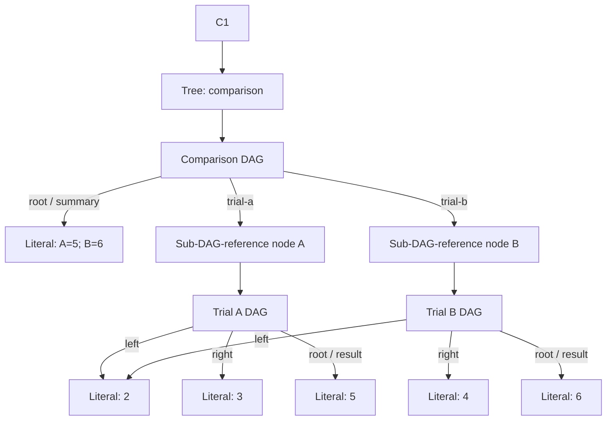

# Iteration 3 worked example: two recorded trials and a comparison

Status: informative planning-time example in the approved design. The turn is now
implemented and published; the actual runnable version is
[composable_dags.py](../../../dml/examples/composable_dags.py). See
[RESULTS.md](RESULTS.md) and [REVIEW.md](REVIEW.md) for actual validation/limits.
The sketches below preserve planning provenance, not a claim that those exact
snippets were executed. [DESIGN.md](DESIGN.md) and [HANDOFF.md](HANDOFF.md) preserve
the bounded plan; work is complete and stopped.

## Purpose and evidence boundary

Record two small Python calculations, compose their DAGs into a comparison, then
replace one trial in a child snapshot. This exercises naming, nested composition,
sharing and inspection without a DML execution engine.

Python calculates the values. Names such as `left`, `right` and `result` are
researcher-authored labels, not built-in argument or dependency roles. The graph
records containment, references and values; it does not establish that a result
was computed from the recorded inputs. There is no recorded implementation binding,
request, attempt, independent-observation accounting or verified methodology.
Those limits are intentional, not evidence of an execution facility.

## First snapshot

Trial A records `2 + 3 = 5`; trial B records `2 + 4 = 6`. Each trial is a DAG whose
root is its result literal node, with named bindings `left`, `right`, `result`.
The result is both the root and a named node; these references identify one node,
not two copies. The literal node holding 2 can be shared by both trial DAGs.

The comparison DAG has a literal summary as root and bindings:

| Name | Target node |
| --- | --- |
| `trial-a` | Sub-DAG-reference node targeting trial A's DAG |
| `trial-b` | Sub-DAG-reference node targeting trial B's DAG |
| `summary` | The root literal node, holding `A=5; B=6` |

`Sub-DAG-reference node` is a candidate representation, not an approved core kind.
These nodes record nested structure; they are not calls and do not evaluate trials.
A tree entry `comparison` points to this comparison DAG. DML commit C1 points to
that tree; ref `main` points to C1.



Arrows show object references. Literal nodes in this diagram also reference their
stored datums, omitted for readability. The two trial DAGs have independently
scoped bindings, so repeated names are unambiguous.

## Construction sketch

This is candidate Python syntax, not working code or an approved API. The helper
is local composition over the low-level API, not a proposed library framework.

```python
import daggerml as dml


def literal(tx, value):
    return tx.put_literal(tx.put_datum(value))


def trial(tx, left, right):
    result = left + right                 # Python computation, not DML execution
    nodes = {name: literal(tx, value) for name, value in (
        ("left", left), ("right", right), ("result", result)
    )}
    return tx.put_dag(root=nodes["result"], bindings=nodes), result


with dml.Repository("comparison.dml", create=True) as repo:
    with repo.write() as tx:
        a, a_value = trial(tx, 2, 3)
        b, b_value = trial(tx, 2, 4)
        a_node = tx.put_subdag(a)
        b_node = tx.put_subdag(b)
        summary = literal(tx, f"A={a_value}; B={b_value}")
        comparison = tx.put_dag(root=summary, bindings={
            "trial-a": a_node, "trial-b": b_node, "summary": summary,
        })
        tree = tx.put_tree({"comparison": comparison})
        c1 = tx.put_commit(tree)
        tx.create_ref("main", c1)
```

Construct child objects before referring to them. Commit the storage transaction
before opening another. Save IDs and exact record bytes for fresh-process checks.

## Child snapshot

In a second write storage transaction:

1. Construct trial B2 recording `2 + 5 = 7`.
2. Construct a new sub-DAG-reference node targeting B2.
3. Reuse the exact trial A DAG and its reference node; do not reconstruct or copy A.
4. Construct a new summary literal `A=5; B=7` and comparison DAG.
5. Construct its tree and commit C2 with parent C1, then update `main -> C2`.

C1 still points to the first comparison, trial B and its summary. No existing
object is rewritten. The new objects identify changed content; identical literal
content can deduplicate across roles without merging research occurrences (none
are modeled by this example).

## Scoped lookup and inspection

Candidate public operations:

```python
with dml.Repository("comparison.dml") as repo:
    with repo.read() as tx:
        a_node_id = tx.lookup_node(comparison, "trial-a")
        a_node = tx.get_node(a_node_id)        # SubDAGNode(dag=a)
        result_node_id = tx.lookup_node(a_node.dag, "result")
        result_node = tx.get_node(result_node_id)
        assert tx.get_datum(result_node.datum).value == 5
```

Lookup is one scope and one name. The comparison's `result` lookup fails even though
its trials have that name. There is no implicit descent, parent fallback or dotted
path parser. `summary` is a named binding; `root` is not a reserved name.

Candidate CLI inspection (substitute actual IDs):

```sh
dml --json --repo comparison.dml snapshot --commit <C1>
dml --json --repo comparison.dml show dag <comparison-dag-id>
dml --json --repo comparison.dml lookup <trial-a-dag-id> result
dml --json --repo comparison.dml walk <comparison-dag-id> --limit 100
dml --json --repo comparison.dml snapshot --ref main
dml --json --repo comparison.dml log --ref main
```

## Acceptance assertions

- Fresh processes see C1's `A=5; B=6` and C2's `A=5; B=7` summaries.
- Explicit descent sees trial B's result 6 and B2's result 7, not a moving binding.
- Both comparisons reference the same A DAG/reference-node IDs and record bytes.
- All saved C1 object bytes are unchanged after publication of C2.
- Root aliases, repeated names in different scopes and shared node targets remain
  visible without repeated object expansion in the candidate `walk` output.
- A separate tiny fixture uses a sub-DAG-reference node as a DAG root, proving that
  inspection does not assume every root is literal.
- Aborted construction and caught mutation failures publish neither new objects nor
  ref movement. A missing lookup is a read failure and does not poison writes.

The implemented executable version and its checks are linked above; the planning
sketch itself was not executed. No trial-count or reproducibility conclusion follows
from this illustrative content graph.
