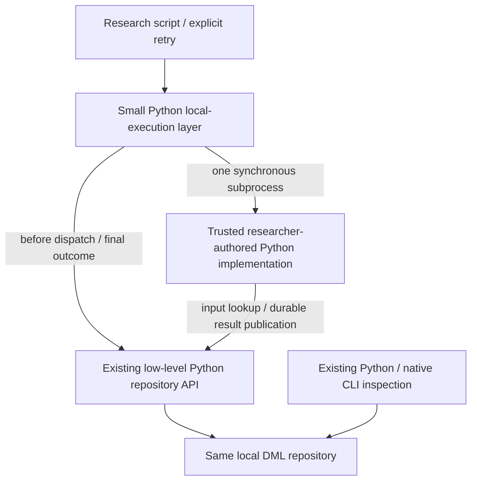

# Iteration 4 candidate design: one locally executed, recorded step

Status: planning provenance for the bounded Iteration 4 turn, subsequently authorized
by the user. Implementation, independent review and publication/CI are complete
through `d498a6c`; all six exact-SHA jobs pass. See [RESULTS.md](RESULTS.md), [REVIEW.md](REVIEW.md) and
[COORDINATION.md](COORDINATION.md). Concrete choices below originated as assistant
proposals; actual selected behavior belongs to the as-built contract.

## 1. Authority and purpose

This document owns the candidate record conventions, local execution boundary and
failure semantics. [EXAMPLE.md](EXAMPLE.md) owns the informative acceptance story;
[HANDOFF.md](HANDOFF.md) owns the conditional implementation sequence and evidence.
Implemented behavior remains in the [as-built specification](../../../dml/docs/spec-next/README.md).
Terms follow the [glossary](../../../dml/docs/spec-next/glossary.md).

### User-agreed direction

- Execute one explicitly bound local Python implementation with named input nodes.
- Record the intent URI, concrete implementation/adapter binding and inputs before
  dispatch, including distinct request and attempt occurrences as ordinary DAG data.
- Obtain a result sub-DAG, then record result or failure in later immutable history.
- Missing final outcome after interruption remains unknown; a retry is a new attempt.
- Use a small Python layer over the existing repository API; add C functionality
  only if a demonstrated missing primitive requires a separate scope decision.
- Acceptance includes two matching additions with distinct attempts/identical result
  content, a failing implementation and interruption after attempt recording.
- No reuse/cache selection, identity facets, intent lifecycle/defaults, asynchronous
  scheduler, repository remotes, cloud, resources or observer/UI subsystem.

This turn tests whether request → attempt → result fits ordinary DAG/commit
machinery. It does not evaluate arbitrary stored graphs, prove scientific validity,
provide exactly-once external execution or finalize closure/environment identity.

## 2. Inspected baseline and architecture

Preparation inspected clean implementation
`9b8fb7176e31186621dd5a4c26adadec4d76bc1e`; the design checkpoint is `cbfcd92`.
No tests/builds were rerun and no implementation/spec files were changed.
[Iteration 3 results](../03-composable-dags/RESULTS.md) are historical evidence.

The [Python API](../../../dml/docs/spec-next/python-api.md) already constructs literal
and sub-DAG-reference nodes, named DAGs, trees, ordered-parent commits and refs.
It provides exact-scope lookup and fail-closed storage transactions. Separate
processes can use one local LMDB repository; multiple wrappers in one process are
unsupported. The [CLI](../../../dml/docs/spec-next/cli.md) can inspect all of this.

Recommend a separate module, provisionally `daggerml.local`, above the low-level
API. One built-in cooperative local-Python adapter is sufficient; no plugin registry,
new C object kind, encoding change, interpreter-specific native binding or CLI
execution command is proposed. Existing sub-DAG nodes remain non-executing.



Parent and child own separate handles. End transactions and close the parent's
repository before launching/waiting for the child; reopen for finalization. Never
hold an LMDB write transaction while waiting on external work. No global handle
registry or multiple-live-wrapper workaround.

## 3. Candidate ordinary-DAG conventions

The fields below are **document-local record-role conventions** interpreted only
by this Python layer, not new primitive semantics or globally reserved names.
Each field is a named node: scalar fields are literals, nested DAG fields use
sub-DAG-reference nodes. Unknown/malformed role records fail closed at the layer.

### Declared local binding and inputs

A local binding DAG has a role literal as root and named bindings:

| Name | Recorded value |
| --- | --- |
| `role` | Root alias: `local-python-binding-v1` |
| `source` | BYTES: captured implementation entry-script source |
| `adapter` | URI identifying this one local adapter contract |
| `interpreter` | Absolute executable path as STRING, not a claim of immutable binary identity |
| `timeout-ms` | Positive I64 execution bound; candidate supported range 1–3,600,000 |

Capture source once and execute the exact captured bytes written into adapter-owned
scratch, not a later reread of a moving source path. Reject source outside a small
explicit supported size (candidate 1 MiB). This captures one entry file, not imports,
Python/DML binaries, environment variables, data files, services or complete code
closure. The adapter contract label describes selected mechanics, not proof that
all dependencies or loaded adapter code are captured. Full closure construction,
installation, intent definitions/defaults and implicit dependencies remain deferred.

The inputs DAG is supplied by immutable ID. Its named nodes are explicit arguments.
The layer validates the DAG/record shape it consumes, but does not impose an
addition-specific schema or recursively convert inputs into Python values. The
implementation explicitly uses lookup and typed reads. No ambient ref selects inputs.

### Request and attempt

Candidate occurrence identifiers are role-qualified UUID4 strings: `q-<32 lowercase
hex digits>` for requests and `a-<32 lowercase hex digits>` for attempts, stored as
ordinary STRING datums. The prefix is part of occurrence identity, so even equal
UUID payloads across the two roles do not alias events. These are not timestamps,
content IDs or reuse facets. Generate them inside the layer; do not accept
caller-selected occurrence IDs in the initial API.

| DAG | Root | Named fields |
| --- | --- | --- |
| Request | Its occurrence-ID literal | `role` = `local-request-v1`; `intent` URI; `binding` sub-DAG; `inputs` sub-DAG |
| Initial attempt | Its different occurrence-ID literal | `role` = `local-attempt-v1`; `request` sub-DAG; `publication-ref` STRING; `scratch` STRING |
| Final attempt description | The same attempt-ID literal | Initial fields plus `status` = `done`, `outcome` sub-DAG and `cleanup` sub-DAG |

The request captures the declared binding and inputs even if launch fails. An
attempt refers to that immutable request description. A retry refers to the same
request but receives a new attempt ID; a separate ordinary invocation creates a
new request as well. No reuse/adoption operation is implemented.

Adding a final description creates a new content-addressed DAG; it does not mutate
the initial record or change occurrence identity. The initial attempt deliberately
has **no adapter status**. Missing outcome is unknown, not `failed` or proof that
no process started. This synchronous adapter returns only a recorded `done` response;
no `created` state or polling/`working` interface is needed in this turn.

### Outcomes, cleanup and result content

- Success outcome: role `local-success-v1`, `result` sub-DAG, exit code 0 and bounded
  stdout/stderr observations. Success requires both normal zero exit and valid
  durable result publication associated with this attempt.
- Failure outcome: role `local-failure-v1`, a bounded classification/detail, observed
  exit code when available, bounded diagnostics and any valid published result as
  **evidence**, not a successful result substitution. Candidate classifications:
  launch, child-exit, timeout, missing-publication, invalid-publication.
- Cleanup DAG: role `local-cleanup-v1`, disposition `ok` or `failed`, bounded detail
  and remaining scratch path if cleanup failed. Computational and cleanup outcomes
  stay separate; successful result plus failed cleanup is allowed.

`done` is recorded only after final outcome and cleanup disposition are persisted.
Candidate outcome field spellings are `role` (root alias), `result` or optional
`evidence` (sub-DAG), `exit-code` (I64, or NULL when unavailable), `reason`/`detail`
(failure STRINGs), and `stdout`/`stderr` sub-DAGs only when observations are available.
A diagnostic DAG is rooted in the retained BYTES and binds `byte-count` (I64) and
`truncated` (BOOL). Cleanup binds `disposition`/`detail` and, on failure, `scratch`.
Unavailable diagnostics are not fabricated empty-output observations.

A storage/finalization error is a caller-visible error with no claimed final status;
external completion alone does not make a repository attempt `done`.

The result DAG is built by the child using ordinary primitives. Do not add request
or attempt identifiers to result content just to distinguish events: two attempts
may legitimately publish the same result ID. Interpret event counting through the
request/attempt records, not result deduplication or repeated `walk` output.

## 4. Candidate publication and commit protocol

Require an existing repository and explicitly supplied head ref, with one driver
owning that head for this turn. Reuse standard trees/commits/refs, not a new journal
format. Preserve unrelated tree entries at each update.

Candidate tree names: `request-<request-id>` and `attempt-<attempt-id>`. Candidate
ordinary refs: `request-<request-id>` (reservation/history anchor, never moved by this
layer after creation) and `attempt-<attempt-id>` (child publication ref). All satisfy
the existing ASCII profile; slash-based `exec/...` names are not supported today.
These are layer conventions, not new core ref categories or protected permissions.

1. Validate binding/inputs, allocate known test/project-owned scratch and select new
   IDs. In one write storage transaction, create request/initial-attempt DAGs, a new
   tree/commit based on the selected head, move that head, and create both refs to
   the pre-dispatch commit. Close handles before any launch.
2. Ref-create collisions abort the entire batch. Regenerate IDs/retry preparation a
   small bounded number of times, with no dispatch until successful publication.
   Retained reservation refs prevent silent occurrence reuse without history scans.
   A retry reuses the existing request/reservation and creates only a new attempt.
3. Pass absolute repository path, exact pre-dispatch commit, attempt ID and publication
   ref to the captured source. Resolve binding/inputs from that pinned snapshot;
   neither party discovers an execution environment from a moving project head.
4. Child constructs a result DAG. A small `publish_result` helper writes a publication
   DAG rooted in the attempt-ID literal, with `role` = `local-publication-v1` and
   `result` sub-DAG. It adds tree entry `publication-<attempt-id>`, constructs a child
   commit with the pre-dispatch commit as parent, and updates only its attempt ref
   atomically in the same transaction. Preserve the starting tree's other entries;
   an unexpected existing publication entry fails rather than being replaced.
   Objects alone or stdout values are not result publication.
5. Parent waits/reaps, then reads the attempt ref and validates the publication role,
   exact attempt association, expected starting parent, unchanged starting tree
   entries plus only the expected publication entry, and result DAG through typed
   API reads. An unchanged ref is missing publication. Scope validation is not
   recursive whole-repository validation or proof the child did honest research.
6. Attempt required scratch cleanup before finalizing. In one write transaction,
   require the coordination head still equals the expected pre-dispatch commit,
   replace only this attempt's tree entry with its final description, retain the
   accepted publication entry when present, and publish the completion commit/head
   movement atomically.
7. With valid child publication, completion parents are the pre-dispatch commit and
   publication commit in that order; otherwise only the pre-dispatch commit. The
   layer explicitly constructs the tree; this is not a general merge operation.
   Retaining the child parent preserves publication history structurally, not merely
   through an ID string in a datum. Keep result/evidence references in the outcome.

A publication helper similarly checks the expected ref target inside its write
transaction rather than blindly overwriting a changed target. Unexpected head/ref
movement produces a conflict error without erasing other writers' history. This is
bounded conditional use of existing transactions, not a concurrency coordinator,
lease, generic CAS API or multi-driver execution guarantee.

No automatic resumption of an old attempt is exported. Every retry gets a new
attempt. Retry validates that the request reservation snapshot contains the supplied
exact request DAG and matching occurrence ID; it never changes that request's
binding/inputs. Discovering a child's publication after parent loss is inspectable
evidence, not automatic finalization or exactly-once proof. Per-occurrence refs
remain rooted; ref deletion, GC and retention-policy automation are outside scope.

## 5. Candidate subprocess boundary and Python surface

### Explicit trust and bounded interaction

Run only deliberately supplied, trusted researcher-authored Python source. Repository
inspection never launches it. This is **not a sandbox**: the child has repository
write access and the local user's authority. Ref ownership and protocol compliance
are cooperative; malicious code can ignore the helper, mutate refs, spawn descendants,
read secrets or affect files/network. No such security guarantee is implied.

One synchronous launch uses an explicit executable and argument vector, no shell
and no PATH guessing. Use controlled scratch as cwd, explicit contract arguments
and no input prompt. Inherit the environment needed for the selected runtime, without
recording/dumping it. The caller owns research policy; no automatic retries.

Use file-backed stdout/stderr, not unbounded pipe buffers. Candidate persisted
observations retain at most 4 KiB per stream as BYTES plus observed byte count and
truncation flag. Preview limits do not bound scratch-disk growth, result/store size,
arbitrary child memory or its descendants. Recorded logs/source may contain sensitive
content; only the caller controls what is safe to record, and no excision facility
is added. Never copy environment-bearing logs/credentials into checked-in reports.

On timeout, attempt direct-child termination and reap it within a separate finite
shutdown bound before recording timeout failure. Failure to establish child
disposition raises a caller-visible error and leaves finalization unavailable,
not fabricated `done` or an indefinite wait. No portable process-tree cleanup is
promised; the supported example creates no descendants. Hard parent interruption
may leave a live child or scratch behind. Test harness cleanup is not an adapter
recovery guarantee. Delete only scratch created/owned by this invocation; do not
follow a historical record's `scratch` string as authority to remove a directory.

### Illustrative APIs, not selected signatures

```text
put_local_binding(tx, *, source: bytes, interpreter: str, timeout_ms: int) -> ObjectId
run_step(repository_path, *, head_ref, intent_uri, binding: ObjectId,
         inputs: ObjectId) -> LocalRun
retry_step(repository_path, *, head_ref, request: ObjectId) -> LocalRun
child_context(argv=None) -> LocalContext
publish_result(tx, context, result: ObjectId) -> ObjectId
```

`LocalRun` is an owned description containing occurrence IDs, pre-dispatch/final
commit IDs, final attempt DAG ID, outcome kind and optional result/evidence ID.
No live handle or cached value substitution. A recorded execution failure returns
an inspectable failure description; validation, conflict or persistence failure
raises a clear exception. If pre-dispatch publication succeeded, that exception
should carry owned request/attempt/pre-dispatch identifiers for inspection, without
claiming a final outcome. Do not claim a recorded failure when its commit failed.

`run_step`/`retry_step` prepare, execute once and finalize in the same caller process.
No public `resume_attempt` or historic-ID re-dispatch. The preparation stage can be
private and separately exercised for deterministic interruption tests. Helpers use
only public low-level operations. `publish_result` participates in the child's
existing write transaction so result objects and ref publication commit together.

Retry reads the original request's binding/inputs; changed code/configuration belongs
to a new request. No installation API, closure registry, generic workflow DSL,
execution CLI command or changes to the existing inspection JSON are proposed.

## 6. Failure checkpoints and limitations

| Boundary | Recorded meaning / action |
| --- | --- |
| Preparation transaction fails | No request/attempt publication or dispatch; attempt scratch cleanup and report storage error |
| Pre-dispatch commit exists; parent stops before spawn | Attempt exists, no outcome/status; launch is not proven |
| Spawn fails normally | Record launch failure plus cleanup disposition in a completion commit |
| Child exits nonzero | Record adapter-contract failure; preserve valid publication as evidence if present |
| Child exits zero without valid publication | Record missing/invalid-publication failure, never invent a result |
| Child publishes; parent dies before final commit | Attempt remains without final status; child ref/history provide separate inspectable evidence |
| Final write fails or head conflicts | No final head change; caller error; retain initial and child history; no automatic retry/resume |
| Scratch cleanup fails after computation | Preserve computational outcome, record cleanup failure and remaining path; allow recorded `done` |

UUID uniqueness is repository-convention enforcement, not global/distributed proof.
The child can produce detailed result internals or a minimal literal wrapper; DML
cannot infer undeclared inputs or certify methodology. Capture, authority, abnormal
process cleanup, concurrent drivers and later reconciliation remain deliberately
limited. No migration/version/compatibility machinery is required before v1.0.0.

## 7. Review checkpoints and stop line

Before implementation approval, review the candidate's main new choices:

1. Small separate Python layer; ordinary role/field conventions, no C evaluation.
2. Captured entry-source bytes, declared runtime/adapter and explicit capture limits.
3. Occurrence reservation/publication refs and atomic pre-dispatch/final commits.
4. Cooperative child-published result with optional two-parent final history join.
5. Failure/unknown/cleanup separation, timeout support and diagnostic limits.

During an authorized turn, record provisional spellings and small replacements.
If this publication convention proves too large, surface a smaller alternative with
its lost evidence rather than silently replacing durability with stdout-only results.
Material scope/model changes need user review. Stop after the example and meaningful
failure/inspection tests; do not add reuse, remotes, scheduling, resource management,
observer hooks or a production execution framework. The planning-only authorization
statement is superseded by [COORDINATION.md](COORDINATION.md), not this stop line.
