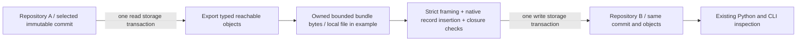

# Iteration 5 candidate design: pinned snapshot transfer

Status: approved bounded plan, subsequently authorized and implemented. Coordinator
review accepts the slice; worker published `0ec769b`, with all six final exact-SHA
CI jobs passing. Turn complete and stopped.
[RESULTS.md](RESULTS.md) and [REVIEW.md](REVIEW.md) own delivery/assurance;
[the as-built contract](../../../dml/docs/spec-next/transfer.md) owns actual behavior.
This plan preserves proposal provenance and illustrative APIs; its preparation-only
permission statements below are historical, superseded by the separate GO request.
No extra workers, release/package publication or later feature turn.

## 1. Authority and goal

This document owns candidate exchange semantics, representation and validation.
[EXAMPLE.md](EXAMPLE.md) owns the acceptance story; [HANDOFF.md](HANDOFF.md) owns
work sequence and evidence requirements. The [discussion](../../discussion.md)
records agreements and authorization; the [as-built specification](../../../dml/docs/spec-next/README.md)
continues to describe implemented behavior only. Terms follow the
[glossary](../../../dml/docs/spec-next/glossary.md).

### User-agreed direction

- Select one immutable DML commit in repository A and transfer its complete
  reachable objects, including parent history, into repository B.
- Preserve exact object IDs, bytes and historical relationships; do not construct
  replacement commits or rewrite request/attempt occurrences.
- Optionally create an explicitly named destination ref atomically with import.
- Inspect the imported snapshot/history through ordinary Python and the existing CLI.
- Reimport does not create another computational attempt or duplicate immutable data.
- Exercise missing dependencies, malformed/identity-mismatched records, ref conflicts
  and failed/interrupted imports without publishing a partial object batch or ref.
- Start with a small Python layer over public repository capabilities. A genuinely
  missing C primitive needs a separate scope decision, not automatic core expansion.

This is a local exchange slice toward later caller/execution-repository exchange,
not a remote execution protocol. No network/cloud, automatic synchronization,
merge policy, shallow history, resumable transfer, reuse/facets, resource management,
observer/UI, execution CLI or general workflow framework.

## 2. Inspected baseline and public-API seam

Planning inspected clean implementation `d498a6cd4eea170c2054690880526c2fbb6ebaa6`
and clean design checkpoint `ee708c4`. No build/test suite or feasibility prototype
ran during preparation; no implementation or as-built file changed. Iteration 4
[results](../04-local-recorded-execution/RESULTS.md) and
[review](../04-local-recorded-execution/REVIEW.md) are prior evidence, not fresh checks.

The public [Python API](../../../dml/docs/spec-next/python-api.md) reads exact packed
records through `Transaction.get_record(kind, id)` and returns typed descriptions
for traversing every implemented immutable object kind. It does **not** currently
expose insertion of already packed records. Native
[`dml_txn_put_datum` / `dml_txn_put_object`](../../../dml/include/dml/repo.h) and the
existing private [`_core.put_record`](../../../dml/python/daggerml/src/_core_module.c)
already validate encoding/type, compute identity, check direct dependencies and
insert with no-overwrite semantics.

**Candidate seam:** add only a public Python
`Transaction.put_record(kind: str, record: bytes) -> ObjectId`, wrapping that existing
native operation under the existing mutation guard. Accept only datum/node/dag/tree/
commit and exact immutable bytes; metadata, refs and unsupported kinds are rejected.
A failed mutation, including conversion, poisons the write context exactly like other
public mutations. Read transactions reject mutation without being ended/poisoned.
No native primitive, new hash/codec, standalone decoder or raw LMDB writer is needed
by this plan. This additive low-level API is part of the approved bounded plan, not
implemented functionality; exact engineering details remain provisional.

A separate explicitly imported module, provisionally `daggerml.transfer`, then uses
**public** operations only. Do not call `_core` directly from the transfer layer,
reimplement packed DML decoding/hashing in Python, or expose test corruption tools.
If this seam is rejected, surface an alternative and its costs before implementation;
do not silently substitute a second structured datum codec.



## 3. Transfer boundary: objects, not ambient repository state

**Object closure** is a document-local term for the set of typed immutable objects
reachable from the selected commit through the following edges. It is not a captured
computational/environment closure.

| Object | Follow these typed edges |
| --- | --- |
| Commit | Tree, then every parent commit in stored order |
| Tree | Every entry DAG in canonical name order |
| DAG | Root node, then every binding node in canonical name order |
| Literal node | Datum |
| Sub-DAG-reference node | Target DAG |
| LIST / SET datum | Every element datum, in stored order |
| MAP datum | Every key and value datum, pair order as stored |
| Other datum | No object edges |

Deduplicate by **(kind, ID)**, not just untyped ID. Include all parents recursively,
including the second publication parent in Iteration 4 completion history; do not
retain only the current tree or first-parent history. Include anonymous/root nodes,
shared sub-DAGs and composite datum children. Rooting at a commit does not mean
reading every object in the source repository.

Do **not** export metadata, source refs, ref names/targets outside these edges,
unreachable objects, other branch-only history, timestamps, repository paths or
filesystem files as transfer metadata. Do not follow URI/STRING/BYTES contents as
object references. Recorded code and paths are data: export/import never evaluates
source, launches a process or deletes a historical scratch directory.

Ordinary request/attempt DAGs transfer unchanged. Their recorded `publication-ref`
and scratch/interpreter strings remain historical data. **Source request-reservation
and attempt-publication refs are not copied.** Publication history retained by commit
parents is inspectable in B, but transferring a completed snapshot does not install
local-adapter reservations, make historical paths usable, or authorize retry/resume
in B. Refs-only progress not reachable from the selected commit is outside this
bundle; select a different commit in a separate transfer if needed.

## 4. Candidate owned-byte bundle

Use a small bounded UTF-8 JSON envelope with opaque base64 packed DML records, not
an archive of filesystem paths, pickle, compressed input or a second DML encoding.

Illustrative shape (abbreviated; not a valid complete bundle):

```json
{"format":"daggerml-commit-bundle-v1","root":"<32 lowercase hex>","objects":[{"kind":"datum","id":"<32 lowercase hex>","record":"<base64 packed bytes>"}]}
```

Candidate rules:

- Exact top-level fields `format`, `root`, `objects`; exact row fields `kind`, `id`,
  `record`. Reject duplicate JSON keys, unknown/missing fields, invalid field types,
  invalid UTF-8/JSON, trailing documents and unknown format labels.
- IDs use the existing lowercase 32-hex parser. Kinds are the five immutable kinds.
  Base64 is strict/canonical: no whitespace, invalid alphabet, noncanonical padding
  or alternate encodings silently accepted. Never trust a declared row ID as native
  proof of identity.
- Rows contain each typed object once, in **dependency-before-dependent** order.
  The selected root commit is the final row. All and only the root's object closure
  must be present, even if dependencies already exist in B. No thin bundle.
- Export uses deterministic iterative depth-first traversal with the edge order in
  Section 3, emitting on exit. Track active versus completed visits to reject cycles;
  shared objects are not cycles. Preserve stored parent and value ordering.
- Export JSON uses a selected stable key/whitespace convention, with no path/time/
  ref/random input. Repeated exports of the same root produce identical bytes.
  Import may accept bounded JSON whitespace and alternative valid topological row
  orders; neither JSON layout nor transfer count creates computational occurrences.
- Candidate fixed prototype bounds: **32 MiB encoded bundle**, **4 MiB per packed
  record**, **16 MiB total packed bytes**, **100,000 rows**. Empty/missing-root bundles
  fail. Boundary fixtures must use short semantic pytest IDs, not giant payload reprs.
  Limits are supported-profile proposals, not universal repository size constraints.

Use bounded byte/string/count checks before base64 decoding or accumulating rows;
reject oversized encoded record fields before decoding. Verify totals incrementally.
The byte API cannot prevent the caller from having already allocated its argument.
JSON parsing, decoded descriptions and native validated reads still allocate;
these profile limits are not an exact RSS bound or execution-time guarantee.
Source `get_record` may allocate a large stored object before its size can be checked.
No new native streaming/read-size primitive is implied; document this limitation.

The wrapper format label is distinct from DML record/schema versions. Unsupported
packed formats fail native validation. No pre-1.0 migrations/version bump or durable
bundle compatibility promise. XXH3-128 content identity is **not authentication** or
a cryptographic adversarial-integrity guarantee; do not invent signed provenance.

## 5. Export protocol

Candidate surface:

```text
export_commit(repository_path, *, commit: ObjectId) -> bytes
```

Require an existing repository and an explicit commit ID, not a moving ref or ambient
`main`. A caller can resolve a ref separately and pass the owned ID. One read storage
transaction traverses the entire pinned closure, using public typed reads and exact
`get_record`. End it and close handles before returning owned bytes.

Missing/corrupt reached objects, cycles or profile violations raise; do not return
a truncated bundle or silently omit history. Later source-ref movement does not
change the root or bytes. No source writes/refs are performed by the layer; ordinary
LMDB opening/locking is not a read-only-filesystem guarantee. Callers must close
other handles for the helper-owned physical repository before calling export/import;
the existing single-wrapper/creating-thread rules remain unchanged. No global handle
registry or path-alias coordination is added.

The first API returns bytes, avoiding an extra installed file-publication subsystem.
The worked example may persist them in a caller-owned local file. Filesystem failure
is not a repository transaction: a partial file is invalid input, not a partial
successful export. If an example uses temporary-file/rename publication, it owns
that scratch and must label its tested filesystem/platform boundary.

## 6. Import protocol and atomicity

Candidate surface:

```text
import_commit(repository_path, bundle: bytes, *, ref: str | None = None,
              map_size: int = 0) -> ImportResult
ImportResult(commit: ObjectId, object_count: int, ref: str | None)
```

Signatures are illustrative; preserve the declared Python minima in actual syntax.
Require an already initialized destination repository. `map_size` uses the existing
repository option and is not automatic growth. `object_count` means validated bundle
rows, **not** newly inserted storage objects, transferred bytes or new attempts.

1. Validate API arguments, bounded JSON framing, rows, IDs, canonical base64 and
   byte/count limits. Keep decoded input owned/stable; no filesystem paths in rows.
2. Open B and start **one** write storage transaction. For each row, call public
   `put_record`, require the computed ID equal the row ID, and check exact packed
   bytes through `get_record`. Native checks remain authoritative for encoding,
   kind, identity and no-overwrite behavior.
3. Read its typed description using public APIs. Every direct dependency must have
   an earlier row in **this bundle**, of the expected kind. Preexisting B data cannot
   substitute for an omitted row. A bad row can temporarily be inserted in the
   transaction before this check; any error aborts the entire unpublished batch.
4. Keep the typed adjacency needed to verify that all supplied rows are reachable
   from the selected root, with no extras, wrong root kind, self/forward/cyclic edges
   or duplicate typed keys. Native direct-reference checks alone are insufficient
   for the layer's **complete bundle** contract. Do not scan unrelated B history.
5. If `ref` is supplied, check it inside this same write transaction. Missing ref:
   create it pointing to the exact root. Existing ref with **same** validated target:
   permit idempotent reimport. Existing different/malformed/unreadable target: error,
   never move/repair it. No implicit overwrite, CAS update, merge or ancestry policy.
6. Commit the storage transaction only after every object/closure/ref check succeeds,
   then close and return an owned `ImportResult`. No new DML commit is constructed.

Do not skip row validation/insertion merely because a key already exists. The native
no-overwrite path must compare identical bytes or reject corruption/collision;
import is not a repair operation. A late bad row, closure error, ref conflict,
map-full or commit error rolls back earlier new objects and ref creation together.
No public caller-owned import transaction in this first API: the helper owns the
abort boundary so caught layer validation errors cannot publish half a batch.

Without `ref`, validated objects are stored but no navigation pointer is created.
The returned root ID is usable for explicit inspection; future GC/retention policy
is outside this turn. With `ref`, no source refs are inferred or installed. Existing
unrelated refs, objects, metadata and their bytes remain unchanged.

Interruption **before commit** leaves no visible batch/ref. Interruption during or
after commit can leave the complete batch published even if no response was received:
absence of acknowledgement is not proof of failure. Likewise, an error after a
successful storage commit cannot undo publication; prepare the owned return description
before commit where practical and never describe postcommit response loss as rollback.
Reimporting the same complete
bundle is safe under the same-target rule; this is not resumable transfer or exactly-
once external execution. Repository creation/file artifacts are not covered by
import atomicity because destination initialization is a separate caller operation.

## 7. Failure boundaries and trust

| Boundary | Required candidate meaning |
| --- | --- |
| Missing source child/parent or corrupt record | Export errors; no incomplete result |
| Truncated/oversized/invalid bundle | Error, no destination publication |
| Packed type/version/canonicalization error or row-ID mismatch | Native/layer error; abort all writes |
| Dependency absent from bundle but present in B | Reject thin input; abort |
| Duplicate, forward dependency or unreferenced row | Reject; abort |
| Existing identical immutable record | Validate and preserve original bytes |
| Existing corrupt/colliding record | Error; never overwrite/repair |
| Different/malformed destination ref | Conflict/error; no ref movement/new batch |
| Native map-full/write/commit failure | Raise; no automatic growth/partial adoption |
| Parent/process loss before storage commit | Fresh readers see old state |
| Parent/process loss after storage commit | Complete publication may exist; inspect/reimport explicitly |

Treat bundles as data with strict bounds/validation, never executable or path-bearing
instructions. This is not a hardened network service or complete hostile-input audit.
Captured source/logs/full parent history may contain sensitive material; no filtering,
erasure, resource copying or privacy guarantee is added. Destination permission and
choice of what history to transfer remain caller policy. A transferred URI's target
can be unavailable or changed. Imported cleanup outcomes are historical reports,
not evidence that resources/scratch at B were cleaned.

## 8. Review checkpoints and stop line

The approved plan includes these principal choices:

1. Narrow public `put_record` wrapper over the existing native insertion seam.
2. Separate transfer module, raw-record JSON/base64 bundle and finite supported profile.
3. Complete all-parent object closure with dependency-first rows; no ambient refs.
4. One atomic import, optional create-or-same-target ref behavior, no partial adoption.
5. Imported local execution records are inspectable history, not executable recovery
   state or automatically recreated reservations/publication refs.

Record provisional engineering replacements during an authorized turn. Material
changes to transfer scope, ref semantics, validation or core capabilities need user
review. Stop after the example, meaningful failure tests and independent acceptance.
No implementation/delegation/publication is authorized by approval of this plan.
