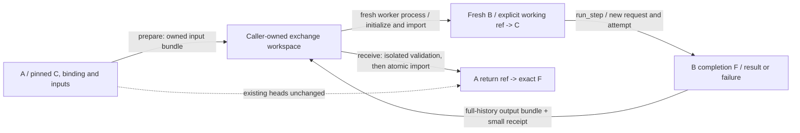

# Iteration 6 candidate design: execution across local repositories

Status: the user approved this bounded design/example/handoff and requested a local
checkpoint ready for handoff. **Implementation, worker assignment/restart,
implementation commit/push, CI launch and package publication remain unauthorized.**
Concrete choices originated as assistant proposals and now guide the approved plan;
illustrative APIs/provisional engineering details remain refinable, not as-built
contracts.

## 1. Authority and goal

This document owns candidate composition, ownership and failure semantics.
[EXAMPLE.md](EXAMPLE.md) owns the acceptance story; [HANDOFF.md](HANDOFF.md) owns
work sequence and assurance. [Discussion](../../discussion.md#iteration-6-agreed-direction-execution-across-local-repositories)
owns agreements; existing as-built [local execution](../../../dml/docs/spec-next/local-execution.md)
and [transfer](../../../dml/docs/spec-next/transfer.md) contracts own current behavior.
Terms follow the [glossary](../../../dml/docs/spec-next/glossary.md).

### Agreed direction

- Pin an input snapshot in caller repository A, transfer it to fresh local B,
  execute one step there, and return B's recorded history to A.
- Create the computational request and attempt **in B after import**, not in A
  before dispatch. Return their original IDs/bytes/occurrences unchanged.
- Keep A's existing head unchanged. Import under an explicitly caller-chosen
  return ref, without adoption, snapshot combination or general merge.
- Same machine, separate processes/repositories, synchronous file-mediated exchange,
  thin Python composition over existing public operations.
- Distinct fresh runs can share result content. Missing returned history is unknown
  at A, not automatically computational failure; B may have recorded an outcome.

Goal: learn whether the existing local runner and full-history transfer suffice for
an inspectable computation across repository boundaries. This is not yet a remote
execution/dispatch protocol. No network/cloud, remote registry, scheduling, polling,
automatic retry/recovery, reuse/facets, caller-reserved cross-repository requests,
resources/GC/excision, observer/UI or general workflow framework.

## 2. Baseline and candidate seams

Planning inspected clean implementation
`0ec769b5e85fde6b6581b628fffdf3465c78a098` and design checkpoint `26c9afa` plus the
subsequent uncommitted discussion. No build/test/prototype ran during preparation.
Iteration 5 [RESULTS](../05-pinned-snapshot-transfer/RESULTS.md) and
[REVIEW](../05-pinned-snapshot-transfer/REVIEW.md) are prior evidence, not fresh tests.

Existing public operations provide the necessary expected seams:

- `Repository`, typed reads/lookup, explicit transactions and initialization.
- `transfer.export_commit` / `import_commit`: bounded exact all-parent bundles,
  initialized destinations and atomic create-or-same-target refs.
- `local.run_step`: one fresh request/attempt, captured implementation, cooperative
  child publication, final computation/cleanup records and owned `LocalRun`.

Candidate new module: explicitly imported `daggerml.exchange`, installed through
existing `python-runtime` tag. It calls public APIs only; no `_core`, private local/
transfer helpers, Python packed codec/hash, native changes or shipped fault hooks.
Keep the existing runner, transfer semantics and CLI unchanged. A missing primitive
requires the smallest reproducer and a separate scope decision.

## 3. Three explicit stages, not a new executor

Prefer three small functions rather than a monolithic launcher/recovery service.
Illustrative surface (not an as-built contract):

```text
prepare_exchange(A, *, commit, binding_name, inputs_name, intent_uri,
                 worker_ref, workspace) -> ExchangeSpec
execute_exchange(workspace, *, map_size=0) -> completed local description
receive_exchange(A, *, workspace, expected: ExchangeSpec, ref,
                 map_size=0) -> ReceivedRun
```

`ExchangeSpec` is an owned frozen selection: a fresh document-local **exchange token**,
input commit, tree-entry names and resolved binding/input DAG IDs, intent URI and
explicit B working ref. Candidate token is UUID4 lowercase hex, generated once per
prepared workspace and echoed in the receipt. It correlates otherwise-identical
jobs; it is not a DML request/attempt occurrence, authentication or a new DAG field.
The workspace path is an out-of-band caller argument, not an object identity or computational
occurrence. `map_size` is the existing repository option for B or final A import,
not automatic growth; private validation uses its own default-sized repository.
Exact return fields/type annotations remain refinable.

`prepare_exchange` selects binding and input DAGs by **tree-entry names in the explicit
commit**, not moving refs or arbitrary unrelated IDs. It reads that commit/tree,
resolves both entries, closes handles, and exports that immutable commit. The
selected DAGs are consequently part of the transferred object closure. Binding
validity for execution remains the local runner's contract; generic DAG structure
is not an argument schema or permission to run untrusted code.

The example's caller launches a fresh installed Python process invoking
`execute_exchange(workspace)` through a small maintained example `--worker` mode.
There is no new user-facing CLI command or production process supervisor. The worker
imports only the package and consumes workspace files/B; it receives **no A path**.
The worker driver then calls the existing local runner, which launches the actual
computational child in its normal separate process.



## 4. Files, one-shot execution and ownership

Candidate workspace: a **new caller-selected directory** whose parent exists.
Preparation creates it without replacing/reusing an existing directory, then writes:

- `input.bundle`: existing transfer format, not a filesystem archive.
- `job.json`: small selection descriptor, written last after the input bundle.
- Worker-created `started`: exclusive one-shot marker, never a DML occurrence.
- Worker-created `worker.dml`: B; initialized separately from import.
- Worker-produced `output.bundle` and `completion.json` after recorded completion.

No A path, arbitrary output filename, shell command or environment dictionary in
these JSON descriptors. Fixed filenames are derived from the caller-supplied
workspace, not from incoming record contents. Paths in DML history remain data.
Reject invalid names/types/IDs/URI selections before dispatch. Physical path aliases,
symlink replacement and malicious simultaneous file writers are outside this trusted,
single-owner prototype; do not claim a filesystem sandbox or cross-process lock.

Candidate framing: strict UTF-8 JSON, exact keys/types, no duplicate keys/nonstandard
constants/trailing documents, lowercase IDs and existing name/occurrence profiles;
**8 KiB per descriptor**. Labels provisionally `daggerml-local-exchange-job-v1` and
`daggerml-local-exchange-completion-v1`. These are transport hints, not new DML kinds.
Job fields encode the `ExchangeSpec`; receipt fields identify exchange token, input
commit, final commit, pre-dispatch commit and request/attempt occurrence strings.
Derive outcome,
result/evidence and cleanup from recorded DAGs, not receipt boolean assertions.
No serialized `LocalContext` with paths treated as runnable authority.

Use bounded file reads (limit + one byte) before allocating bundle/descriptor input,
using existing transfer profile values rather than drifting copies. Parsing/record
reads still allocate; this is not an RSS or execution-time bound. No compressed input,
archive extraction, pickle or standalone packed decoder.

`execute_exchange` checks descriptor/framing, rejects an existing B or output pair,
and acquires `started` exclusively **before initializing/importing/dispatching**. A prior marker,
including one left before any DML attempt exists, prevents another execute call.
A failed launch/bootstrap is not permission to clear the marker automatically.
This deliberately sacrifices transparent retry to prevent acknowledgement loss from
silently starting a second computation. No distributed exactly-once guarantee.

Import C into newly initialized B with the explicit working ref. Verify imported
root/selected entries against the descriptor; close all handles before `run_step`.
The fresh working ref is created deliberately, not inferred/copied from A.
Execution creates new local reservation/publication refs in B normally.

A completed `LocalRun`, including computational **failure**, permits export of its
exact `final_commit`. Local persistence/coordination/IO exceptions do not fabricate
a completion receipt. The worker writes the owned output bundle, then publishes
completion descriptor **last**, via same-directory temporary-file/replace where
supported. Its normal exit is zero for either a recorded success or failure; an
exchange/driver error exits nonzero with bounded diagnostics. Stdout is not the
result protocol. Never auto-receive from an incomplete pair merely because a file
exists or a process exited zero.

File publication and B/A storage commits are separate boundaries. Rename is not a
cross-file/cross-repository transaction or power-loss durability guarantee. Catchable
IO errors are reported; interruption may leave temporary/partial files. After response
loss, callers may explicitly inspect the retained files/B or call receive if a complete
pair exists. That is re-reading evidence, not automatic recovery or re-execution.

The workspace and B are **retained on success and failure**, owned by the caller.
No automatic recursive workspace/B deletion: it can be the only copy of an unreturned
outcome. Existing local runner cleanup owns only its newly allocated execution scratch;
its cleanup report does not describe workspace disposition. Validation scratch below
is helper-owned and temporary; cleanup failure cannot undo a committed return import.

## 5. Validate the selected computation before touching A

A valid generic bundle alone does not prove it is the requested completion. Avoid
publishing a wrong-job return ref and checking associations afterward.

Candidate receive sequence:

1. Read completion/output into owned bounded values. Compare job selection against
   caller's owned **expected** `ExchangeSpec`, not just a worker-supplied descriptor.
   A fresh receiver obtains expected selection from caller-controlled input, not
   from the receipt. Require receipt token match expected (including otherwise-identical
   jobs), and base/final IDs and occurrence fields be valid. Token echo provides
   cooperative packet correlation, not independent proof of execution or provenance.
2. Create a private temporary validation repository. Use **public** `import_commit`
   without a ref to validate the complete returned bundle. Require its root equal
   the receipt's final commit. This staging store is not a public partial-import,
   callback, resume or repair API; failure cannot mutate A.
3. Through public reads, validate only this selected one-step completion against
   the existing local conventions (checks below). Prepare owned `ReceivedRun`.
4. Close validation handles and attempt cleanup of its allocated scratch **before**
   A publication. On cleanup failure, raise without importing into A and identify
   only helper-owned remaining scratch. Retain the caller's workspace unchanged.
5. Import the same owned output bundle into A with explicit return ref using the
   existing atomic `import_commit`. Return only after successful storage commit;
   never move another head or create a replacement DML commit.

This duplicates local storage/import IO in return validation, not codecs or execution.
It is a deliberate simple prototype cost, preferable to widening transfer with a
validation callback or new native primitive. Do not promise large-scale performance.

Selected-completion checks, using history rather than absent copied reservation refs:

- Base commit and selected binding/input entries match expected IDs. Pre-dispatch
  has exactly `(base,)` as parents and preserves base tree, adding only this request
  and initial attempt. Fresh names must not replace old entries.
- Request role/root/intent/binding/inputs match expected selection and receipt
  occurrence. Initial attempt role/root/request/publication-ref match that request
  and occurrence; scratch is historical data, never inspected on disk.
- Final tree preserves pre-dispatch entries except the selected attempt's final
  description, plus accepted publication when present. Final occurrence/request
  association remains exact; status is `done`; outcome and cleanup have the existing
  expected roles/typed consumed fields.
- Ordered completion parents are pre-dispatch, followed by accepted publication
  if present. Publication has exactly pre-dispatch as parent, preserves its tree
  plus the correct occurrence-associated result entry, and agrees with result or
  failure evidence. A completion without accepted publication has one parent.
- Success has zero exit and a result DAG; failure has its recorded reason/detail
  and optional evidence, not a synthesized successful result. Cleanup disposition
  is separately `ok` or `failed`; preserve failed cleanup even on success.

A small read-only inspector in the exchange module may read these consumed fields
using public descriptions. The local as-built contract continues to own their
representation; no second executor, reservation recreation or universal schema
validator. Exact strict-field handling should follow current local records and be
recorded in the as-built exchange contract. All-parent bundle validation supplies
transitive object completeness, not scientific/capture validity or authentication.

`ReceivedRun` should own returned commit/ref/count, pre-dispatch/request/attempt IDs,
final attempt, computational outcome, optional result/evidence and cleanup. Avoid a
`LocalContext` implying that copied paths/refs are operational in A. Count remains
bundle rows, not attempts or newly inserted objects. Receive can be repeated safely;
execute cannot. It requires no live B or original source files after a complete
return packet and independent expected selection are supplied.

## 6. Failure and interruption boundaries

| Boundary | Candidate meaning |
| --- | --- |
| Invalid selection/input export | No worker launch; A unchanged; preparation may leave caller-owned files |
| B initialization/import/map-full failure | No computational dispatch; partial filesystem artifacts may exist; retain workspace |
| B imported, before local pre-dispatch | One-shot marker is not proof of a request/attempt or child start |
| Local initial records committed, no completion | B's attempt remains unknown; A receives nothing automatically |
| Computational failure durably finalized | Return its history normally; exchange success is not computation success |
| Worker terminated/final write failed | No trustworthy completion response; B may contain progress/publication/completion |
| B final commit persisted, output export/file fails | Computation can be done in B while A has no outcome; do not rerun |
| Missing/truncated/mismatched return packet | Reject receive before A writes; preserve B/files |
| Valid bundle, wrong job/occurrence/history | Reject in private validation store before A writes |
| A late import/ref/map-full/commit failure | Existing transfer whole-batch rollback; B completion still valid |
| A storage commit succeeded, caller response lost | Complete objects/ref may exist; no acknowledgement does not mean rollback |

A working-ref/result-file collision is an error, not auto-name/overwrite/repair.
A's existing different-target return ref is a conflict; same-target re-receive is
idempotent. Another writer moving A's main does not retarget the pinned input or
permit this helper to restore main. There is no atomic transaction spanning A, B,
files and child effects, and no automatic retry on **any** stage error.

The example supervisor uses finite worker waits and finally-owned terminate/kill/
reap of the direct worker. The existing binding timeout controls the computational
child inside `run_step`. Stopping the worker does **not** portably stop its child or
descendants; hard caller loss can leave both running. Preserve workspace; do not
remove it while writers may remain. Deterministic tests use barriers before child
launch or after child reaping, and separately qualify any descendant evidence.
No portable spawn/LMDB-call/global wall-clock deadline or process-tree guarantee.

## 7. Trust and limits

Only cooperative trusted caller/worker/source is supported. Same-machine processes
have local-user authority; withholding A's path from worker arguments is a functional
separation test, **not access control**. Inherited runtime/environment/imports are
not captured; the same recorded interpreter path must work in B. No relocation,
package bootstrap, sandbox, signed receipt or adversarial worker authentication.

Full parent history/code/logs can be sensitive and output can exceed the transfer
profile after otherwise successful execution. Neither successful computation nor
binding timeout guarantees exportability, bounded disk/memory use or immediate
response. Local scratch cleanup failures and unknown attempt state transfer as
reports, not maintenance obligations executed by receive. No glossary redefinition
of computational closure, remote, request or attempt.

## 8. Review choices and stop line

The approved bounded plan includes these assistant-origin choices:

1. Separate explicit prepare/execute/receive stages; subprocess orchestration in
   the runnable example, not a new general launcher.
2. Fresh retained caller-owned workspace/B, small bounded descriptors, distinct
   transport tokens and a local one-shot marker; no automatic repeat execution or
   cleanup of research history.
3. Select DAGs by names in pinned C; use the unchanged local runner in B.
4. Validate the returned selected computation in a disposable repository before
   A's unchanged atomic transfer import; no transfer callback/native expansion.
5. Separate received computation/cleanup descriptions from exchange errors; no
   runnable `LocalContext` manufactured in A.

Exact spelling/signatures remain provisional and may be refined during a separately
authorized implementation turn. Material scope/ref/occurrence/failure-policy changes
need user review. Stop after the worked example, meaningful failure assurance and
independent acceptance. Approval of this plan authorizes no implementation,
delegation, implementation commit/push or CI launch.
